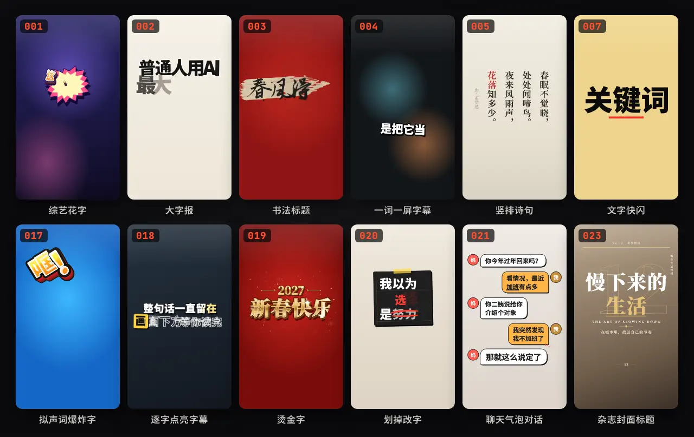
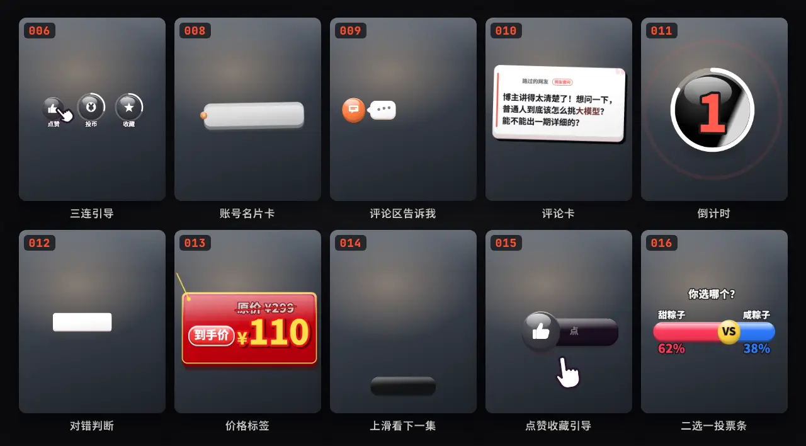

<!-- README.en.md is generated from docs/README.en.template.md. Edit the template, then run in engine/:
     node cli/catalog.mjs --lang en --template ../docs/README.en.template.md --readme ../README.en.md
     The counts and the "All styles" table come from each style's meta.json. Don't edit them by hand in README.en.md. -->

# hanzifx

<p align="center"></p>
<p align="center"><a href="https://bitmanalan.github.io/hanzifx/">Live gallery (edit the text and play)</a> · <a href="https://github.com/BitmanAlan/hanzifx/releases/tag/v0.1.0">Full showreel and all sample videos</a></p>

**Chinese short-video text effects for AI agents: 12 text effects and 10 interactive overlays. Describe what you want in one sentence and get variety-show captions, poster headlines, word-by-word captions, vertical poems and outro animations.**

Chinese typesetting done right: no line breaks in the middle of a word, no punctuation at the start of a line, and correct punctuation in vertical text.

<p align="center"></p>
<p align="center"><sub>Text effects: 001 Variety Outline, 002 Big Poster, 003 Brush Title, 004 Word Pop Captions, 005 Vertical Verse, 007 Type Flash, 017 Sound Burst, 018 Karaoke Captions, 019 Gold Foil, 020 Strike & Rewrite, 021 Chat Bubbles, 023 Magazine Cover</sub></p>

<p align="center"></p>
<p align="center"><sub>Interactive overlays (cropped to the element and enlarged; they go on top of your video): 006 Triple Tap, 008 Profile Card, 009 Comment Prompt, 010 Comment Card, 011 Countdown, 012 Right or Wrong, 013 Price Tag, 014 Swipe Up, 015 Single Tap, 016 Vote Bar</sub></p>

Each cell is that style's signature look, exported straight from the code in this repo. The only editing is the layout and cropping.

`Code: MIT` · `Style docs: CC BY-NC 4.0` · `Zero-dependency styles` · `Chinese typesetting checks` · `Frame-exact renders`

[中文](README.md) · [Built for agents](#built-for-agents) · [Get started in one sentence](#get-started-in-one-sentence) · [What to say](#what-to-say) · [All styles](#all-styles) · [Output](#output) · [Requirements](#requirements) · [Updating and uninstalling](#updating-and-uninstalling) · [Make your own style](#make-your-own-style) · [Limitations](#limitations) · [FAQ](#faq) · [Using it responsibly](#using-it-responsibly)

---

## Built for agents

This library is meant to be driven by an agent. You say what you want in plain Chinese or English; the agent does the rest.

- **One sentence to install.** Send your agent the repo address and say "install hanzifx for me". It installs the dependencies, downloads the fonts and verifies their sha256, runs a self-check, and links the skill into your agent's skill folder.
- **The agent picks the style.** Every style states what it is for, what it is not for, and which style to use instead. If you don't name a style, the agent picks one, tells you which and why, and goes ahead.
- **Word segmentation is checked before export.** Chinese has no spaces, so you cannot know where a line may break until the text is segmented into words. The check prints the segmentation on one line. When the agent sees a wrong split, it marks the allowed break points with `|` and exports again. Line breaks inside a word, punctuation at the start of a line, outlines clipped by the frame edge and missing glyphs are all reported; nothing is exported silently with these problems.
- **Results you can verify.** Every export comes with `manifest.json` (input parameters, browser version, fonts, a sha256 for every frame, all check results) and `timeline.json` (intro, hold and outro segments, plus the moment each character lands, in frames). The agent uses them to check its work and to sync music and sound effects.
- **Same input, same frames.** All randomness comes from a seed. Rendering with 4 workers in shuffled order matches rendering with 1 worker in order, frame for frame (see [Limitations](#limitations) for the scope).

Measured: we ran the 5 prompts under [What to say](#what-to-say), each in a fresh Claude Code session given only that one sentence. All 5 came out right, at an average of 1.17 US dollars each (0.94 to 1.47), usually in about 2.5 minutes. The one with 30 seconds of real speech to align took 7.5 minutes, mostly spent exporting the video. Details: [`skills/hanzifx/tests/RESULTS.md`](skills/hanzifx/tests/RESULTS.md) (in Chinese). Only tested with Claude Code so far.

---

## Get started in one sentence

Send this to your agent:

> Install hanzifx (https://github.com/BitmanAlan/hanzifx), then use 005 to set 「床前明月光，疑是地上霜。举头望明月，低头思故乡。」 as a vertical poem, signed 「唐·李白」.

The agent clones the repo, runs `bash scripts/install_skill.sh` to install dependencies, download fonts, run the self-check and link the skill, then checks the text and exports a vertical mp4.

To install it yourself:

```bash
git clone https://github.com/BitmanAlan/hanzifx hanzifx
cd hanzifx
bash scripts/install_skill.sh     # dependencies, fonts with sha256 check, self-check, then link the skill; safe to run again
```

`install_skill.sh` links the skill into whichever of these folders already exist: `~/.claude/skills` (Claude Code), `~/.codex/skills` (Codex), `~/.agents/skills`, `~/.dsh/skills` (DeepSeek Harness). To install dependencies and fonts without linking the skill, run `NO_LINK=1 bash scripts/install_skill.sh`. The Codex and DeepSeek Harness folders follow their public docs and have not been tested yet.

Without an agent:

```bash
cd engine
npm run check  -- --style styles/005-vertical-verse --text "床前明月光，疑是地上霜。举头望明月，低头思故乡。"
npm run export -- --style styles/005-vertical-verse --text "床前明月光，疑是地上霜。举头望明月，低头思故乡。" --set author="唐·李白"
```

---

## What to say

### Prompts you can copy

Copy any of these to your agent. `*…*` marks the keyword to emphasize. These 5 prompts are also the skill's test cases, so they stay in Chinese exactly as tested.

1. 用 002 把「普通人用AI最大的误区，是把它当*搜索引擎*」做成大字报，要封面效果。
   (Use 002 to turn this line into a big poster, cover style.)
2. 用 005 把「春眠不觉晓，处处闻啼鸟。夜来风雨声，*花落*知多少。」做成竖排诗句，署名「唐·孟浩然」，水墨卷轴。
   (Use 005 to set this poem vertically, signed by the poet, ink-scroll look.)
3. 用 001 把「这也太*好笑*了吧」做成综艺花字，透明底，我要叠在视频上。
   (Use 001 to make this a variety-show caption on a transparent background, to lay over a video.)
4. 用 004 给这段口播配一词一屏字幕，这是逐字时间文件（没有的话按语速估）。
   (Use 004 to add word-by-word captions to this voice-over; here is the per-character timing file, or estimate from speaking rate.)
5. 用 006 做一个三连引导，横排，透明底，放在片尾。
   (Use 006 to make a like-coin-save outro, horizontal, transparent background.)

### Not sure which style

You don't need to remember the numbers. Just say what you are making:

> I need an opening for a voice-over about personal finance that grabs attention in the first 2 seconds.

The agent checks each style's "good for" and "not for (use instead)" and picks one, for example the signature look of 002 Big Poster: a whole sentence fills the frame with the keyword line biggest, made for the opening of an opinion piece. If you want captions for the whole clip, it will point you to 004 instead.

### Two looks

Every style has a **default** look for everyday use and a **signature** look that goes bigger, for covers, openings and showcases. Ask for "cover style" or "more dramatic" and the agent uses the signature look. Palettes, rhythm and the random seed can all be changed too; the parameters are listed in each style's `meta.json`.

---

## All styles

12 text effects and 10 interactive overlays. Each style has its own folder: `STYLE.md` covers how it works, its parameters, pitfalls and check results (in Chinese), and `demo/` holds posters and GIFs. "Prototype" in the Status column means the style works and passes its checks, but its parameters and look may still change.

<!-- hanzifx:styles-index:start -->
<!-- Generated from each style's meta.json by engine/cli/catalog.mjs. Don't edit by hand. -->
| Code | Name | 中文名 | Type | What it does | Default / Signature | Status |
|---|---|---|---|---|---|---|
| 001 | Variety Outline | 综艺花字 | Text effect | Variety-show captions with four layers of outline and an extruded 3D edge: characters pop in one by one, sway gently while on screen, then shrink and fly off one by one. | V1 Bounce / V3 Variety Max | Prototype |
| 002 | Big Poster | 大字报 | Text effect | A whole sentence fills the frame: every line stretches to full width and the keyword line is the biggest, so the size contrast carries the layout. | V1 Everyday / V3 Viral Cover | Prototype |
| 003 | Brush Title | 书法标题 | Text effect | A big calligraphy title in running script: ink bleeds into textured paper or sweeps on in one stroke, and a red seal stamps the corner at the end. | V1 Ink Wash / V3 Splash Ink | Prototype |
| 004 | Word Pop Captions | 一词一屏字幕 | Text effect | Talking-head captions that show one or two words at a time, big and centered, changing screen by screen with the speech. Chinese is segmented into words first, so a word like 误区 never gets split across two screens. | V1 Everyday / V3 Signature | Prototype |
| 005 | Vertical Verse | 竖排诗句 | Text effect | A poem set vertically, right to left: columns fade in character by character, punctuation, quotes and numbers follow vertical-text rules, and a small seal stamps the end. | V1 Clear Read / V3 Ink Scroll | Prototype |
| 006 | Triple Tap | 三连引导 | Interactive overlay | The like-coin-favorite "triple tap" for outros and calls to action: a hand presses and holds the like button, rings charge up, and all three buttons light up and burst together. All icons are drawn from scratch; transparent background, made to overlay your video. | V1 Everyday / V3 Signature | Prototype |
| 007 | Type Flash | 文字快闪 | Text effect | Fast type-flash on the beat: one word per screen, hard cuts on the beat and words slamming into frame. Stays under the WCAG flash limit by default. | V1 Everyday / V3 Signature | Prototype |
| 008 | Profile Card | 账号名片卡 | Interactive overlay | An end card for your account: round avatar, name, one-line bio and a Follow button slide up; a finger taps it and the button flips to Following with a check mark. Drawn from scratch, transparent background. | V1 Everyday / V3 Signature | Prototype |
| 009 | Comment Prompt | 评论区告诉我 | Interactive overlay | An end-of-video ask for comments: a comment icon pops up, three dots bounce in a speech bubble as if someone is typing, the question types out character by character, then "tell me in the comments" appears with an arrow pointing down. | V1 Everyday / V3 Signature | Prototype |
| 010 | Comment Card | 评论卡 | Interactive overlay | A comment card to overlay while answering viewer questions: avatar, name and the comment text, broken only at word boundaries, with the words being answered swiped with a highlighter. An original layout that doesn't copy any platform's comment section. | V1 Everyday / V3 Signature | Prototype |
| 011 | Countdown | 倒计时 | Interactive overlay | A 3-2-1 for openings, reveals and challenges: big numbers pop in once a second while a ring sweeps clockwise from twelve o'clock, then a closing line lands. Transparent background. | V1 Everyday / V3 Signature | Prototype |
| 012 | Right or Wrong | 对错判断 | Interactive overlay | A statement on a card, struck out by a big X or approved with a check drawn in one stroke. For myth-busting and do's and don'ts. Transparent background. | V1 Everyday / V3 Signature | Prototype |
| 013 | Price Tag | 价格标签 | Interactive overlay | A price tag for shopping and review videos: the original price appears and gets struck through, the deal price slams in and rolls down to the final number, and a "save ¥…" badge pops up. Transparent background. | V1 Everyday / V3 Signature | Prototype |
| 014 | Swipe Up | 上滑看下一集 | Interactive overlay | An end-of-episode prompt for short dramas and series: a hand swipes up with a trail, three chevrons light up in turn, and the line below hops character by character. Transparent background. | V1 Everyday / V3 Signature | Prototype |
| 015 | Single Tap | 点赞收藏引导 | Interactive overlay | A prompt for one action: tap Like, double-tap for hearts, light up Save with a spin, or bounce the Share arrow, with a short line beside it. Icons drawn from scratch, transparent background. | V1 Everyday / V3 Signature | Prototype |
| 016 | Vote Bar | 二选一投票条 | Interactive overlay | Which one would you pick? Two options' percentage bars grow side by side while the numbers roll up to exactly 100% in total, then the winner grows and gets a crown. Two stacked bars or one head-to-head bar. Transparent background. | V1 Everyday / V3 Signature | Prototype |
| 017 | Sound Burst | 拟声词爆炸字 | Text effect | Comic-book sound effects that slam into the frame: chunky extruded lettering on a jagged burst with halftone dots, a hard shake on impact, and several words can land one after another. | V1 Everyday / V3 Signature | Prototype |
| 018 | Karaoke Captions | 逐字点亮字幕 | Text effect | Talking-head captions that show the whole sentence dimmed in the lower part of the frame and light it up character by character as it is spoken; marked keywords switch to an accent color with a small pop. One sentence per screen, transparent background, ready to lay over the video. | V1 Everyday / V3 Signature | Prototype |
| 019 | Gold Foil | 烫金字 | Text effect | A one- or two-line gold foil title: a band of light sweeps across and stamps the metal letters in, then glints keep running over them. Draws its own red ground or goes transparent. | V1 Everyday / V3 Lunar New Year | Prototype |
| 020 | Strike & Rewrite | 划掉改字 | Text effect | A word in the sentence gets crossed out in one stroke and the corrected word is written above it or slams in right after it. Made for twists, corrections and self-mockery. | V1 Everyday / V3 Signature | Prototype |
| 021 | Chat Bubbles | 聊天气泡对话 | Text effect | A whole chat laid out from a script: bubbles pop in one by one on the left and right, with three typing dots before the other person's messages. Bubbles size to their text and wrap only at word boundaries; long chats scroll up. The bubble design is our own, not copied from any messaging app. | V1 Everyday / V3 Comic Punchline | Prototype |
| 023 | Magazine Cover | 杂志封面标题 | Text effect | A magazine-cover layout: a large serif Chinese headline with a widely tracked English line, hairlines, a masthead and an issue number, set in plenty of white space. Each part fades in while its letter spacing slowly tightens, and the keyword gets a fine underline at the end. | V1 Everyday / V3 Special Issue | Prototype |
<!-- hanzifx:styles-index:end -->

---

## Output

- **Finished video**: MP4 in 9:16, 16:9 or 1:1. Text effects come with a studio backdrop by default so you can see the result right away.
- **Transparent overlays**: ProRes 4444 `.mov` and VP9 `.webm`, both with an alpha channel, or a PNG sequence. Interactive overlays export with a transparent background by default, to lay over your own video.
- **A single image**: a PNG at the style's poster moment, or at any moment you choose (`--poster`, `--still`).
- **With every export**: `manifest.json`, `timeline.json` and the font subset used.

---

## Requirements

1. **Node 20 or newer.**
2. **ffmpeg** with ffprobe. macOS: `brew install ffmpeg`; Windows: `winget install ffmpeg`; Linux: `apt install ffmpeg`. MP4 needs libx264; transparent output needs the ProRes and VP9 encoders.
3. **A browser.** `install_skill.sh` downloads a version-pinned headless browser (about 100 MB). It gives the most stable frame-by-frame results and lets machines without Chrome export. To skip the download, run `NO_BROWSER=1 bash scripts/install_skill.sh` and your installed Google Chrome is used instead; after Chrome updates itself, your frames may no longer match other people's. Without the install script, install it yourself: `cd engine && npx playwright-core install --only-shell chromium`. If both are present, the headless browser is used.

If anything goes wrong, run `cd engine && npm run doctor` first. It lists what is missing and how to fix it.

- **Fonts**: `npm run fonts` downloads them from the official Google Fonts repository and verifies their sha256. All fonts are under the OFL and can be used commercially. Each export embeds a subset with only the characters it uses.
- **Speed**: on our development machine (Apple M5 Pro, 48 GB RAM, macOS 26.5), a 3 to 4 second vertical interactive overlay takes 5 to 7 seconds to capture with 4 workers, plus encoding.
- **Styles that need extra input**:
  - 004 Word Pop Captions: for exact timing, give it per-character timestamps. SRT subtitles and whisper output can be converted with `styles/004-word-pop-captions/tools/to-words.mjs`; without timing it estimates from speaking rate.
  - 007 Type Flash: to sync to music, pass the beats in seconds with `--beats`.
  - Every other style needs only a line of text.
- **Try it in the browser**: `cd engine && npm run dev`, then open http://127.0.0.1:5180/engine/player/. Drag the timeline, edit the text, switch palettes and looks, and copy the export command.

---

## Updating and uninstalling

- **Update**: run `git pull` in the repo folder, then run `bash scripts/install_skill.sh` again. It brings the dependencies, fonts and headless browser up to what the new code needs and points the skill links again. It is safe to run repeatedly.
- **Uninstall**:
  1. Remove the skill links. The install script creates a link named `hanzifx` in each of these folders that already exists on your machine: `~/.claude/skills/hanzifx`, `~/.codex/skills/hanzifx`, `~/.agents/skills/hanzifx`, `~/.dsh/skills/hanzifx`. For example `rm ~/.claude/skills/hanzifx`. They are only links; removing them does not touch the repo.
  2. Delete the repo folder. The dependencies, fonts and intermediate export files all live inside it.
  3. The headless browser lives in Playwright's shared cache (`~/Library/Caches/ms-playwright` on macOS, `~/.cache/ms-playwright` on Linux). Other projects may use it too; delete it only when you are sure nothing else needs it.

---

## Make your own style

A style is a folder: `style.js` draws the frames, `meta.json` defines the parameters, palettes, rhythms and looks, and `STYLE.md` explains how it works and what was checked.

- Template: [`docs/STYLE-TEMPLATE.md`](docs/STYLE-TEMPLATE.md) (in Chinese).
- How to write one, and the hard rules: [`engine/docs/写一个新风格.md`](engine/docs/写一个新风格.md) (in Chinese). For example, set opacity on individual shapes, never on a group, and never scale text non-uniformly; break these and shuffled rendering stops matching.
- Before you submit, run `npm run check` (Chinese typesetting checks), `npm run determinism` (frame-exact renders) and `node cli/catalog.mjs` (required fields).
- How to contribute: [`CONTRIBUTING.md`](CONTRIBUTING.md).

---

## Limitations

- **Frame-exact rendering has three conditions**: the same machine, the same browser version and the engine's default launch flags. Other machines, operating systems and browser versions have not been tested.
- **Segmentation still makes mistakes**: it relies on a word list plus rules. On a set of fresh sentences that the people writing the word list had never seen, 56.0% of 109 sentences were segmented entirely correctly, with 43 splits inside a word; the browser's built-in segmenter scored 12.8% with 144. New brand names and internet slang are the most likely to be split wrong. The check prints the segmentation; mark the allowed break points with `|` where it is wrong.
- **Most platform fits are inferred**: we have measured only two rounds of Douyin videos. Anything marked "(inferred)" was not measured on that platform.
- **Safe areas are rules of thumb**: the bottom 20% and right 15% are left for platform buttons and text. There is no official spec.
- **Avatars are text only**: 008 Profile Card and 010 Comment Card can only show the first character of the name as the avatar, not an image yet.

---

## FAQ

**Why do the fonts have to be downloaded separately?**
Font files are large and each has its own license, so they are not in the repo. `npm run fonts` (the install script runs it for you) downloads them from the official repositories and verifies each sha256. All are OFL 1.1 and can be used commercially. Each export embeds a subset with only the characters it uses. If downloads are slow in mainland China, set `HANZIFX_FONTS_MIRROR` to a mirror; see [`engine/FONTS.md`](engine/FONTS.md).

**Can I use the videos commercially?**
Yes. The videos you make with this library are yours, including for commercial use, with no credit required, and the code is MIT. What you may not sell are the style docs themselves. The full terms are in [`docs/LICENSING.md`](docs/LICENSING.md).

**What does "frame-exact" mean?**
With the same text and parameters, rendering with 4 workers in shuffled order and with 1 worker in order gives the same sha256 for every frame, and all randomness comes from a seed. So rendering the same sentence again gives the same video, and an agent can check it against the per-frame sha256 in `manifest.json`. This holds on the same machine, with the same browser version and the engine's default launch flags (see [Limitations](#limitations)).

**What if a word is split wrong?**
Look at the segmentation line the check prints, mark the allowed break points in your text with `|` (for example `这也太|好笑了吧`), and run the check again. You can also wrap the word in `*…*` to mark it as a keyword.

**What do I need installed?**
Node 20 or newer, ffmpeg and a browser. The install script downloads a version-pinned headless browser, or you can use your installed Google Chrome (see [Requirements](#requirements)). Development and testing are done on macOS. The automated tests on GitHub run the unit tests and checks on Ubuntu, but no videos have been exported on Linux, and Windows has not been tested.

---

## Using it responsibly

- 007 Type Flash limits flashing to WCAG 2.3.1 by default (no more than 3 flashes in any 1 second) and refuses to export if the limit is exceeded. Strong flashing must be turned on explicitly with `flashMode=strong`; the export then warns about photosensitivity and records it in `manifest.json`.
- The icons and layouts of the interactive overlays (likes, follows, comment cards and so on) are drawn by this project and do not copy any platform's interface. Don't use them to pass off fake platform screens or numbers, such as faked follower or like counts.
- Use the fonts under their own licenses, all SIL OFL 1.1.

---

## License

In short: **use the code freely; the videos you make with it are yours, including commercially; don't sell the style docs.** [`docs/LICENSING.md`](docs/LICENSING.md) has the full terms; the root `LICENSE` is the MIT text and covers the code only.

- **Code**: scripts in `engine/`, `scripts/` and `skills/`, each style's `style.js` and `meta.json`, and the icons drawn for the styles are MIT.
- **Style docs**: each style's `STYLE.md`, the docs in `docs/` and the skill's `SKILL.md` are CC BY-NC 4.0 plus a film-making permission: you and the people working with you may follow and adapt them to make your own videos, commercial and client work included. Selling them, or putting them into a product or service run for commercial advantage, needs a separate commercial license; the contact details are in [`docs/LICENSING.md`](docs/LICENSING.md).
- **Demo videos, posters and GIFs**: CC BY 4.0.
- **Fonts**: all SIL OFL 1.1. The font files are not in the repo; `npm run fonts` downloads them from the official repositories. Licenses are in `engine/fonts/LICENSES/`.
- **Videos you make with this library**: yours, including for commercial use, no credit required.

---

If you find it useful, a star helps more people making Chinese short videos find it.

[](https://star-history.com/#BitmanAlan/hanzifx&Date)
